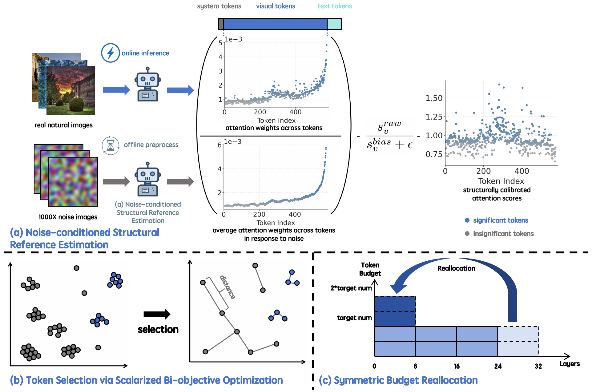
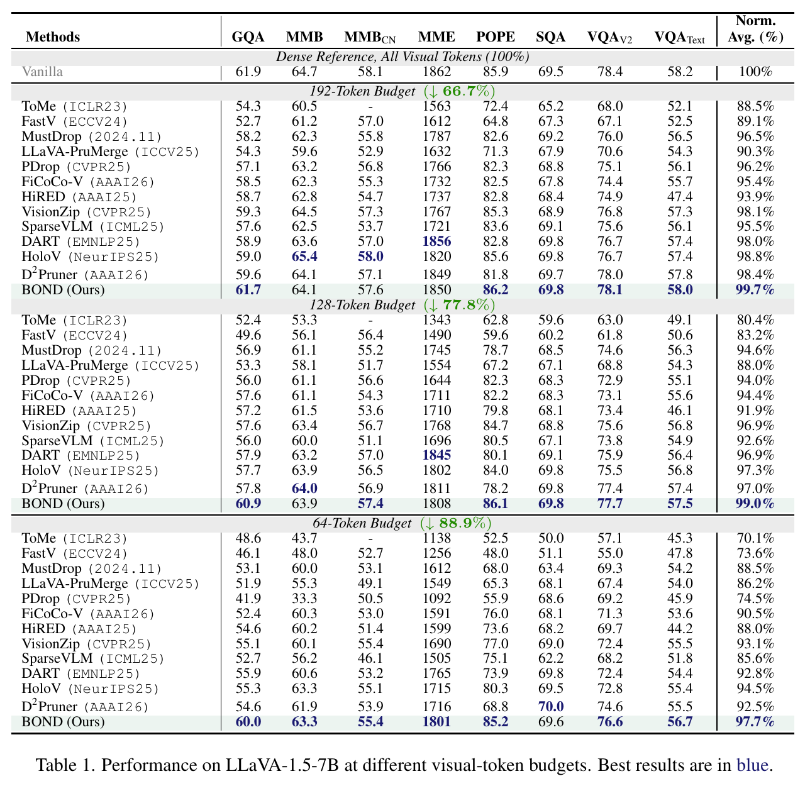
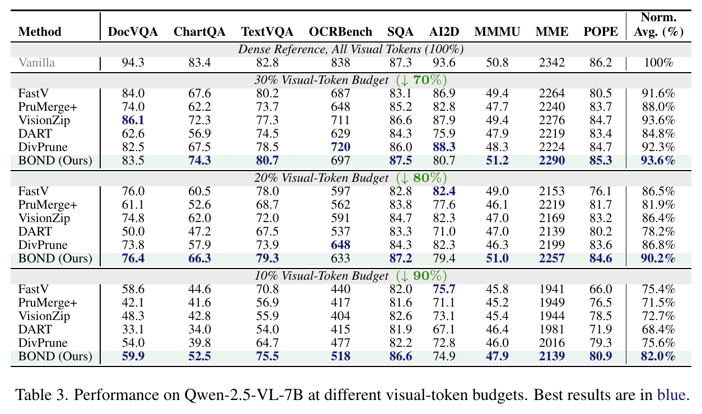
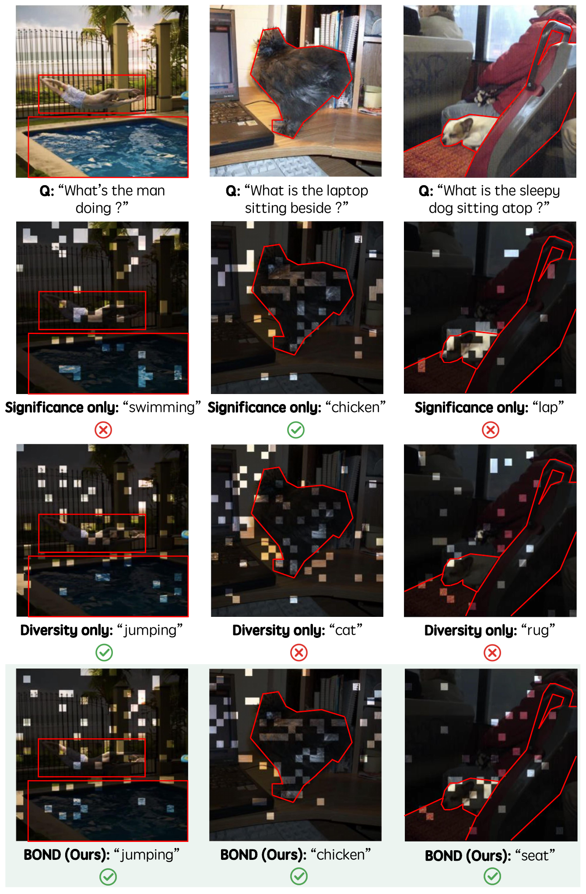
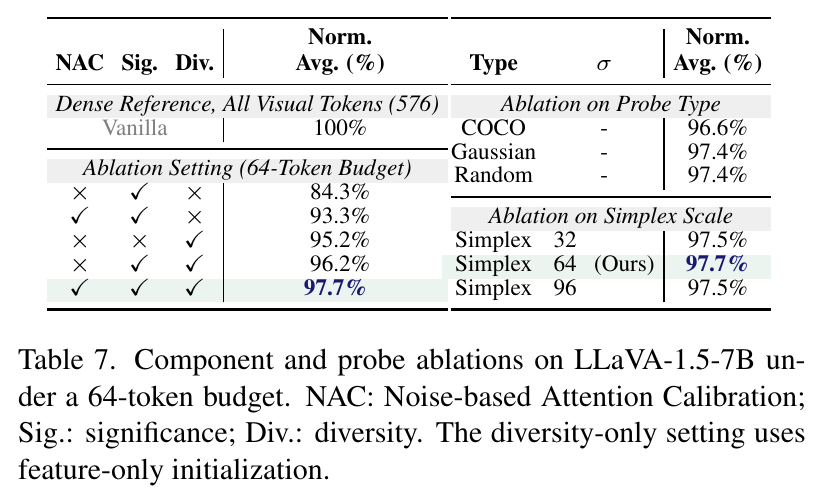
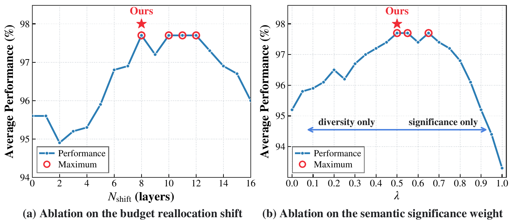

# BOND

**Layer-Wise Structural Reference Calibration with Synthetic Probes for Visual-Token Pruning**

BOND is a training-free visual-token pruning framework. It calibrates attention
with synthetic Simplex probes, combines significance and diversity for token
selection, and reallocates a fixed aggregate token budget across decoder layers.

This release provides offline reference-score generation and image inference
and evaluation for **LLaVA-1.5-7B** and **Qwen2.5-VL-7B-Instruct**.

## Method Overview

BOND combines three complementary components:

- **Noise-based Attention Calibration (NAC):** constructs model- and layer-specific spatial references from synthetic Simplex probes, without a natural-image calibration corpus.
- **Significance–diversity selection:** balances calibrated attention scores with feature-space diversity to preserve task-relevant evidence and complementary context.
- **Symmetric Budget Reallocation (SBR):** shifts visual-token capacity from later to earlier decoder layers while preserving the aggregate layer-wise token budget.

<p align="center">
  <a href="assets/paper/method_overview.png">
    
  </a>
</p>

## Main Results

The following tables reproduce the main-paper image results. **Norm. Avg. (%)**
is the equally weighted mean of benchmark scores normalized by the corresponding
dense-model scores. Budgets follow the paper's average layer-wise prunable
patch-token convention.

### LLaVA-1.5-7B

BOND retains **97.7%** of dense normalized performance at a **64-token budget**,
and **99.0% / 99.7%** at 128 / 192 tokens.

<p align="center">
  <a href="assets/paper/results_llava15.png">
    
  </a>
</p>

### Qwen2.5-VL-7B

BOND retains **90.2% / 82.0%** of dense normalized performance at the
**20% / 10% budgets**, respectively.

<p align="center">
  <a href="assets/paper/results_qwen25vl.png">
    
  </a>
</p>

## Qualitative Analysis

Significance-only and diversity-only selectors produce different retention
patterns. The examples below show how BOND combines calibrated significance
with feature-space diversity.

<p align="center">
  <a href="assets/paper/retained_tokens.png">
    
  </a>
</p>

## Ablation Study

### Components and Calibration Probes

The component and probe-source ablations examine calibration, significance,
diversity, probe type, and Simplex scale under a 64-token budget.

<p align="center">
  <a href="assets/paper/ablation_components.png">
    
  </a>
</p>

### Hyperparameter Sensitivity

The following plots show sensitivity to the budget reallocation shift and the
significance–diversity weight under a 64-token budget.

<p align="center">
  <a href="assets/paper/hyperparameter_sensitivity.png">
    
  </a>
</p>

## Installation

Use separate Python 3.10 environments for the two backbones. Run commands from
the repository root. The LLaVA metadata retains its original Torch 2.1.2 and
Transformers 4.37.2 dependency pins:

```bash
pip install -e .
pip install flash-attn==2.3.3 --no-build-isolation
```

For Qwen, the original implementation uses the Transformers 4.55 API. The
source environment has Torch 2.4.0, torchvision 0.19.0, Transformers 4.55.4,
FlashAttention 2.6.3, and qwen-vl-utils 0.0.14:

```bash
pip install torch==2.4.0 torchvision==0.19.0
pip install -e ./lmms-eval
pip install transformers==4.55.4 qwen-vl-utils==0.0.14 opensimplex==0.4.5.1 shortuuid
pip install flash-attn==2.6.3 --no-build-isolation
export PYTHONPATH="$PWD:$PWD/lmms-eval${PYTHONPATH:+:$PYTHONPATH}"
```

The shell entrypoints set numerical-library thread counts to one. Qwen launches
one evaluation process by default (`NUM_PROCESSES` overrides this), and its
probe-image generator defaults to one worker (`NOISE_WORKERS`).

Checkpoint locations can be set with `LLAVA_MODEL_PATH` and `QWEN_MODEL_PATH`.
An optional [.env.example](.env.example) lists these settings; scripts read the
calling shell's environment. To use the example, copy it to `.env`, edit the
paths, and run `source .env` before invoking a script.

## Offline reference scores

The full-token recording implementations are kept at
`llava/model_testFull/` and
`Qwen2_5-VL/Qwen2_5VL/modeling_qwen2_5_vl_self_full_test.py`.
The Simplex scripts record per-layer `relation_vis_text` using attention
normalized over all causally visible keys, averaged over heads and instruction
queries. Every visual token is retained during reference recording. The scripts
append to `REFERENCE_SCORE_FILE`; use a fresh output file for each independent bank.

LLaVA Simplex references (1,000 probes, scale 64):

```bash
export LLAVA_MODEL_PATH=/path/to/llava-v1.5-7b
bash myPlayground/emptyTest/noise_test_simplex.sh
python myPlayground/emptyTest/process.py \
  myPlayground/emptyTest/output/description/relation_vis_text_empty_with_description_Simplex_64.jsonl \
  --output-dir myPlayground/emptyTest/output/description/csv_output
```

Qwen Simplex references (1,000 probes, scale 64, original 640-pixel probe size):

```bash
export QWEN_MODEL_PATH=/path/to/Qwen2.5-VL-7B-Instruct
MODE=generate bash myPlayground/emptyTest/noise_test_qwen2_5_simplex.sh
MODE=eval bash myPlayground/emptyTest/noise_test_qwen2_5_simplex.sh
python myPlayground/emptyTest/process.py \
  myPlayground/emptyTest/output/description/relation_vis_text_empty_with_description_Simplex_64_qwen.jsonl \
  --output-dir myPlayground/emptyTest/output/description/csv_output/Qwen
```

`process.py` computes the per-position mean, variance, and standard deviation.
Both generation and inference use `Simplex_64` in their default reference filenames.

Both backbones initialize selection with the token of maximum calibrated
importance and maintain running minimum feature distances during greedy
selection. Qwen aligns its reference to the original merged image grid using
bilinear interpolation; surviving patches retain their original grid coordinates.

## LLaVA image evaluation

Place benchmark inputs in the original `playground/data/eval/` layout. The
provided scripts retain the original filenames and annotation splits:

| Benchmark | Inputs under `playground/data/eval/` | Entrypoint prefix |
| --- | --- | --- |
| GQA | `gqa/llava_gqa_testdev_balanced.jsonl`, `gqa/data/images/`, official evaluation annotations in `gqa/data/` | `gqa` |
| MMBench EN/CN | `mmbench/mmbench_dev_20230712.tsv`, `mmbench_cn/mmbench_dev_cn_20231003.tsv` | `mmbench`, `mmbench_cn` |
| MME | `MME/llava_mme.jsonl`, `MME/MME_Benchmark_release_version/` | `mme` |
| POPE | `pope/llava_pope_test.jsonl`, `pope/coco/`, `pope/val2014/` | `pope` |
| ScienceQA | `scienceqa/llava_test_CQM-A.json`, `scienceqa/images/test/`, official annotations | `sqa` |
| TextVQA | `textvqa/llava_textvqa_val_v051_ocr.jsonl`, `textvqa/train_images/`, `textvqa/TextVQA_0.5.1_val.json` | `textvqa` |
| VizWiz | `vizwiz/llava_test.jsonl`, `vizwiz/test/` | `vizwiz` |
| VQAv2 | Original `vqav2/` question and image paths specified by the scripts | `vqav2` |

The scorer reads the generated Simplex bank by default. Set
`ATTN_DEBIAS_STATS_DIR` and `ATTN_DEBIAS_CSV_TEMPLATE` when using a different
reference location:

```bash
export LLAVA_MODEL_PATH=/path/to/llava-v1.5-7b
export ATTN_DEBIAS_STATS_DIR="$PWD/myPlayground/emptyTest/output/description/csv_output"
CUDA_VISIBLE_DEVICES=0 bash scripts/v1_5/eval/sysEval/gqa_64.sh
```

Use the corresponding benchmark prefix and `_64.sh`, `_128.sh`, or `_192.sh`.
`getRes_64.sh` and `getRes.sh` retain the original local result collection.
MMBench, VizWiz, and VQAv2 retain their original submission-file converters.

## Qwen image evaluation

The original image script is retained with its original filename (quote the
space). Its task list is
`ai2d,chartqa,docvqa_val,pope,textvqa_val,mme,ocrbench,scienceqa,mmmu_val`.
Dataset locations and split/prompt/metric definitions are kept in
`lmms-eval/lmms_eval/tasks/`; benchmark data is obtained separately.

Qwen applies the SBR schedule after layers 0, 2, and 26 (zero-based). Passing
`False` as the launcher's first argument disables all BOND pruning stages.

```bash
export QWEN_MODEL_PATH=/path/to/Qwen2.5-VL-7B-Instruct
CUDA_VISIBLE_DEVICES=0 bash 'Qwen2_5-VL/eval_scripts/lmms_eval copy.sh' True 0.1
```

The second argument selects the average retention budget: `0.1`, `0.2`, or
`0.3`. It configures the original three-stage schedule with multipliers
`(2r, r, 0)` at layers `(0, 2, 26)`. The default remains `r=0.1`.
`QWEN_REFERENCE_CSV_TEMPLATE` optionally overrides the default per-layer CSV
path; its layer placeholder is `{}`.

## Repository Layout

```text
llava/
  model/                         LLaVA image inference and BOND selection
  model_testFull/                 Original full-token reference recorder
  eval/                          Original image evaluation entrypoints
scripts/
  v1_5/eval/sysEval/              Per-benchmark scripts at 64/128/192 tokens
  convert_*.py                   Original result/submission converters
playground/
  data/eval/                     Dataset layout and original GQA/MME evaluator code
Qwen2_5-VL/
  Qwen2_5VL/                     Original Qwen model and reference recorder
  eval_scripts/lmms_eval copy.sh  Original nine-benchmark image launcher
lmms-eval/                       Local evaluation framework and image task definitions
myPlayground/
  emptyTest/                     Original probe generators and reference statistics
```

Only source code, task configurations, packaging files, and documentation are
included. Checkpoints, datasets, probe images, reference CSVs, and predictions
are supplied or generated separately.

## Development

Formatting and syntax checks use Ruff 0.14.3 and run without loading model
weights. See [CONTRIBUTING.md](CONTRIBUTING.md) for the commands and contribution
guidelines. Model execution and benchmark reproduction are separate validation
steps.

## License and acknowledgments

The original Apache-2.0 license and source notices are retained. The bundled
evaluation framework and S2 helpers retain their own licenses. See
[THIRD_PARTY_NOTICES.md](THIRD_PARTY_NOTICES.md) for component attribution.
